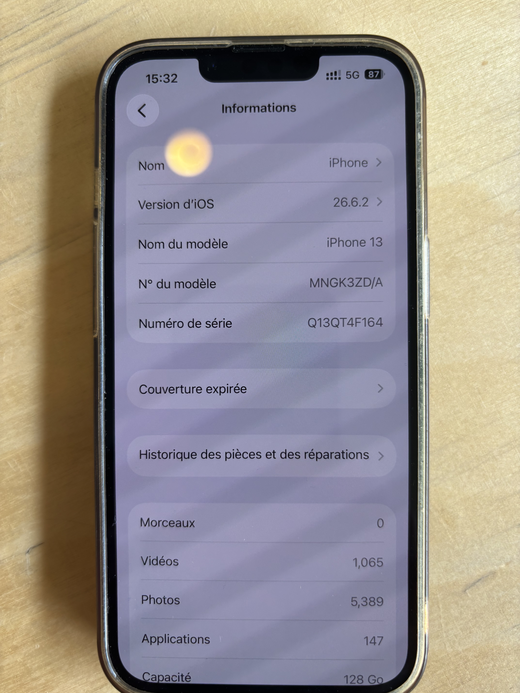

# Note de constatation de la couleur et des identifiants de TP-01

**Dossier :** SADEDINE-2026  
**Personne concernée :** Mme Malika Sadedine, DMM Conseils  
**Prestataire :** Christophe Donnat, Donnat Dev  
**Date de rédaction :** 17 novembre 2026

## Constat sur la couleur de l’appareil

**Le téléphone remis et examiné sous la référence de mission TP-01 est un Apple iPhone 13 de couleur verte, et non noire.** La couleur verte est consignée dans l’annexe 1 de l’attestation de remise, avec le numéro de série **Q13QT4F164** et la référence de modèle **MNGK3ZD/A**.

Les procès-verbaux de visite et de saisie du **15 octobre 2024** et d’ouverture des scellés et de saisie du **28 octobre 2024** décrivent pour leur part le téléphone placé sous le **scellé n° 2** comme un **iPhone 13 noir**. Il existe donc une divergence de couleur entre cette description et celle du téléphone TP-01 remis au prestataire.

## Identifiants du téléphone

| Élément | Identification |
|---|---|
| Référence de mission | **TP-01** |
| Marque | Apple |
| Modèle | iPhone 13 |
| Couleur constatée et consignée à la remise | **Verte** |
| Numéro de série | **Q13QT4F164** |
| Référence du modèle | **MNGK3ZD/A** |
| IMEI transcrit dans l’attestation | **35 876346 861150 5** |
| Type produit relevé dans la sauvegarde | `iPhone14,5` |
| UDID de la sauvegarde associée | `00008110-000A70993407801E` |

Le numéro de série de l’attestation et celui du fichier `Info.plist` de la sauvegarde concordent exactement. La photographie ci-dessous permet également de lire **Q13QT4F164** et **MNGK3ZD/A** sur l’écran de l’appareil. L’IMEI est reproduit tel qu’il figure dans l’attestation ; il n’est pas visible sur cette photographie.

## Photographie de l’appareil

**Photographie jointe :** `remise-documents/photos/TP-01-1.jpg`.

Cette vue de face documente les identifiants affichés à l’écran. Elle ne montre pas clairement la couleur du dos du téléphone ; le constat de couleur verte repose sur l’identification du matériel consignée lors de sa remise.

## Portée du rapprochement avec les procès-verbaux

Les passages des procès-verbaux contrôlés ne fournissent pas de numéro de série ou d’IMEI permettant de confirmer à eux seuls que TP-01 correspond au scellé n° 2. La présente note documente la couleur et les identifiants de TP-01 ainsi que la divergence de description relevée dans les procès-verbaux. Le code de mission **TP-01** reste distinct du numéro de scellé.

## Pièces de référence

- [Attestation de remise, annexe 1, téléphone TP-01](remise-documents/attestation-de-remise.md).
- [Rapport d’analyse technique de TP-01, section 2.1](telephones/analyse-TP-01.md#21-identité-de-la-sauvegarde).
- [Lecture des procès-verbaux, identification des téléphones](investigations/20261108-analyse-pv/compte-rendu.md).
- [Procès-verbaux communiqués, réunis dans le dossier de procédure](docs/PV%20DE%20SAISIE.pdf).

Fait à Perpignan, le 17 novembre 2026.

**Christophe Donnat**  
Donnat Dev, prestataire en analyse informatique

Signature :
