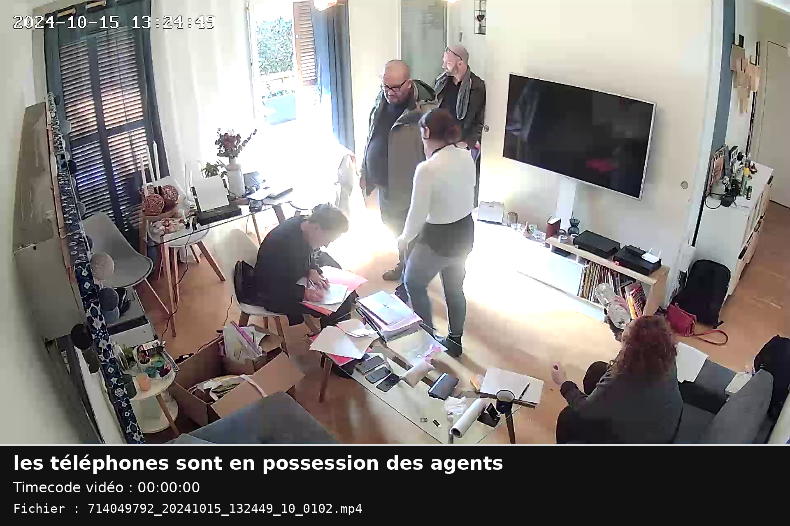
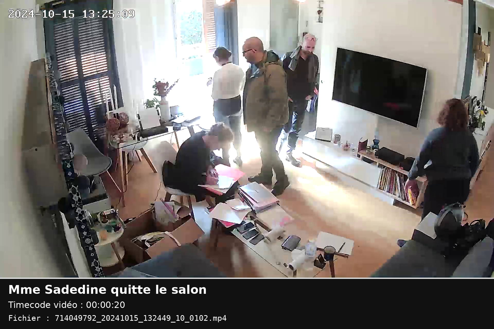
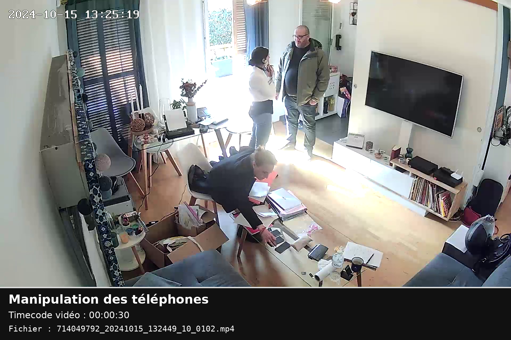
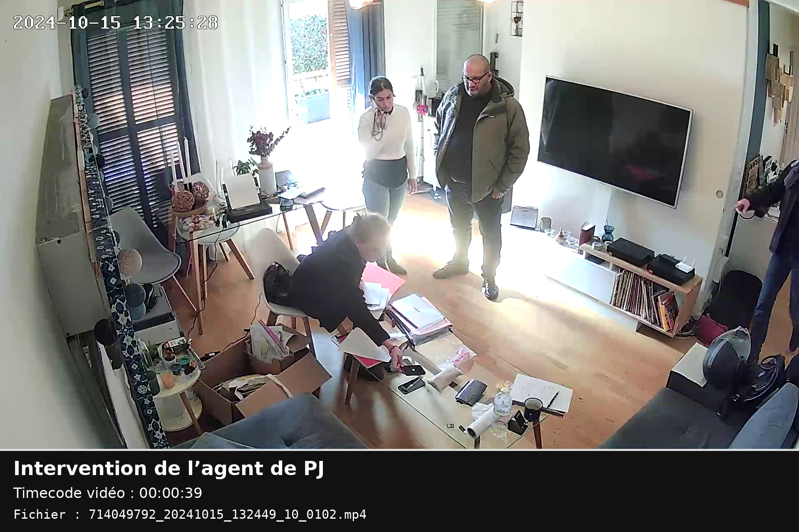
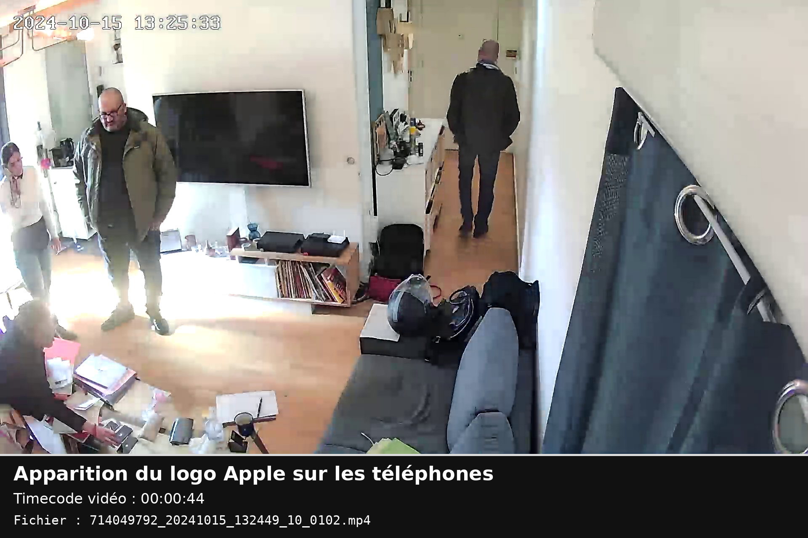
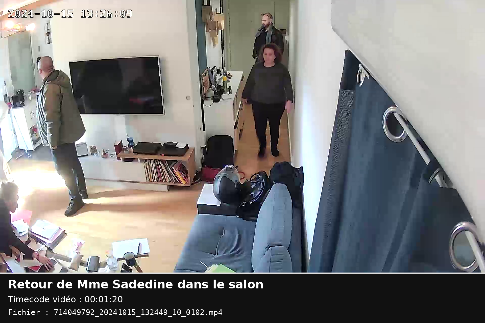

**Christophe DONNAT**  
**DONNAT DEV — Entrepreneur individuel**  
Prestataire en analyse informatique  
40 rue Albert Janicot 66000 Perpignan
christophe@donnat.dev

# NOTE DE CONSTATATION
**Examen des enregistrements vidéo du 15 octobre 2024**

**Dossier :** SADEDINE-2026  
**Personne concernée :** Mme Malika SADEDINE  
**Date de rédaction :** 16 novembre 2026  
**Complément photographique :** 17 novembre 2026

Je soussigné, **Christophe DONNAT**, atteste avoir procédé, dans le cadre de ma mission d'analyse informatique pour Mme Malika Sadedine, à l'examen des enregistrements vidéo qu'elle m'a communiqués, relatifs aux opérations du 15 octobre 2024.

Sur la base des images visionnées et des horodatages affichés sur les enregistrements, les événements suivants sont relevés :

| Heure affichée | Constatation |
|---|---|
| **Vers 09 h 46** | Arrivée supposée des enquêteurs. Sur les vidéos, je constate que la porte est ouverte et plusieurs personnes se tiennent sur le seuil devant Mme Sadedine. |
| **Vers 13 h 24** | Mme Sadedine remet ses trois téléphones aux enquêteurs. |
| **13 h 25 min 10 s** | Mme Sadedine quitte le salon pour se rendre aux toilettes, accompagnée d'un homme qu'elle identifie comme étant un officier de police judiciaire. |
| **13 h 25 min 19 s** | Une femme, identifiée par Mme Sadedine comme étant Mme Adam, intervient sur les trois téléphones. Les logos Apple apparaissent sur leurs écrans, ce qui est caractéristique de la séquence de démarrage d'un iPhone. |
| **13 h 25 min 29 s** | L'homme précédemment mentionné revient dans le salon, semble adresser une remarque à la personne identifiée comme Mme Adam, puis repart dans le couloir. |
| **13 h 26 min 11 s** | Mme Sadedine revient dans le salon. |

### Observations, interprétation et provenance des identités

La porte ouverte, les déplacements, les gestes sur les téléphones et l’apparition d’écrans sont des observations visuelles. Le démarrage est l’interprétation technique de l’apparition des logos. Les noms et qualités des personnes sont attribués par Mme Sadedine.

**La séquence d’extinction demandée n’est pas documentée par les six captures ni par un repère vérifiable dans la présente note.** Je ne la tiens donc pas pour acquise. L’état à la fermeture et la continuité d’alimentation restent inconnus ; un extrait montrant chaque extinction et la mise sous scellé permettrait de les examiner.

### Précisions et limites du constat

Les identités et qualités des personnes mentionnées sont celles communiquées par Mme Sadedine. Elles n'ont pas fait l'objet d'une vérification indépendante dans le cadre de cette note.

L'apparition des logos Apple est compatible avec un démarrage des appareils. Elle ne permet pas, à elle seule, de déterminer leur état antérieur, ni de constater un déverrouillage ultérieur.

Les heures indiquées correspondent aux horodatages visibles sur les enregistrements fournis.

La présente note se limite aux éléments visuels constatés sur les enregistrements et aux indications expressément attribuées à Mme Sadedine.

## Captures de la vidéo du salon

Les six captures ci-après proviennent du fichier `714049792_20241015_132449_10_0102.mp4`. Les timecodes indiquent le temps écoulé depuis le début de ce fichier ; ils sont distincts de l’horloge incrustée dans les images. Les légendes et les références sont ajoutées dans un bandeau sous l’image, sans masquer ni retoucher la scène enregistrée.

### Contrôle des légendes et des repères

J’ai relu les six captures lors de la révision du 18 novembre. Les bandeaux d’origine sont conservés comme annotations ; les qualités de personnes qu’ils emploient reposent sur les indications de la cliente. Une image fixe ne suffit pas à vérifier toute la séquence décrite dans le tableau de visionnage.

| Capture / temps relatif demandé | Heure incrustée visible | Portée de l’image fixe |
|---|---|---|
| 1 / 00:00:00 | 13:24:49 | Personnes et téléphones sur la table ; la qualité d’agent n’est pas déduite de l’image. |
| 2 / 00:00:20 | 13:25:09 | Départ d’une personne identifiée par la cliente ; repère voisin du récit à 13:25:10, sans identité d’image à la seconde. |
| 3 / 00:00:30 | 13:25:19 | Personne penchée sur la table, geste vers les téléphones ; un geste n’établit pas un déverrouillage. |
| 4 / 00:00:39 | 13:25:28 | Homme debout près de la table ; le titre « agent de PJ » du bandeau n’est pas vérifiable visuellement. |
| 5 / 00:00:44 | 13:25:33 | Vue d’ensemble et petits écrans sur la table ; l’identification des logos dans le visionnage ne se résume pas à cette miniature. |
| 6 / 00:01:20 | 13:26:09 | Personne revenant vers le salon ; le récit à 13:26:11 porte sur la séquence, pas exactement sur cette image fixe. |

Les PTS réellement retenus, la méthode et les empreintes sont dans le [journal d’extraction](investigations/20261117-captures-constatation/extraction.json) et la [notice](investigations/20261117-captures-constatation/README.md). Les pixels de la scène sont conservés ; aucune nouvelle extraction vidéo n’est présentée comme exécutée par la révision.

### Capture 1 à 00:00:00

### Capture 2 à 00:00:20

### Capture 3 à 00:00:30

### Capture 4 à 00:00:39

### Capture 5 à 00:00:44

### Capture 6 à 00:01:20

---

Révision documentaire : 18 novembre 2026. Les dates des faits et des analyses restent celles indiquées dans le texte.

Christophe Donnat — Donnat Dev
