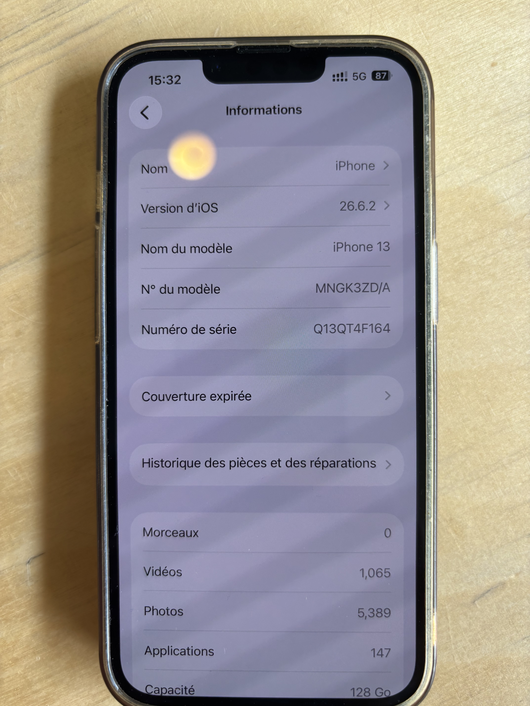

# Note de constats techniques

**Dossier :** SADEDINE-2026 — Mme Malika Sadedine, DMM Conseils  
**Auteur :** Christophe Donnat — Donnat Dev  
**Date :** 18 novembre 2026

Cette note reprend les observations consignées dans les rapports et les relevés techniques référencés ci-dessous. Elle est distincte de ces rapports. Elle présente les faits observés, leurs sources et leurs références, avec une ligne de limite technique par constat. Les heures sont celles enregistrées dans les artefacts, exprimées en heure de Paris lorsque leur conversion est documentée : UTC+2 les 15 et 17 octobre 2024, UTC+1 le 28 octobre 2024. Les timecodes vidéo indiquent un temps écoulé ; les heures incrustées sont reproduites séparément.

## Identification des appareils et des pièces

Les codes **OP-01**, **TP-01**, **TP-02**, **TP-03** et **SD-03** sont les références de mission employées dans l’attestation de remise et les rapports. Ils désignent les équipements suivants :

| Référence | Équipement ou pièce | Identifiants et source examinée |
| --- | --- | --- |
| **OP-01** | Ordinateur portable **ASUS UX333F NOTEBOOK PC** | Série **KAN0CV116290436** ; image du disque Windows examinée dans le rapport OP-01. |
| **TP-01** | Téléphone **Apple iPhone 13** | Série **Q13QT4F164**, modèle **MNGK3ZD/A** ; photographie de l’écran « Informations » et sauvegarde associée. |
| **TP-02** | Téléphone **Apple iPhone 13 mini** | Série **F5466LV9V7**, modèle **MLK83KH/A** ; sauvegarde identifiée par `Info.plist`. |
| **TP-03** | Téléphone **Apple iPhone 13 mini** | Série **Y4Q9KGHG26**, modèle **MLK83F/A** ; sauvegarde identifiée par les champs `Lockdown` de `Manifest.plist`. |
| **SD-03** | Carte mémoire **32 Go**, associée aux vidéos du **salon** | Marque transcrite « ScanDisk » dans l’attestation, sans série individuelle confirmée ; image acquise sous les noms `SD03.E01` à `SD03.E12`. |
| **CD « DMM »** | Désignation du support d’origine indiquée par la cliente | Disque non remis au prestataire ; seul le fichier transmis **`Inventaire_saddedine.csv`** a été examiné. |

**Sources d’identification :** [attestation de remise, annexe 1](remise-documents/attestation-de-remise.md) ; rapports [OP-01, § 3.1](ordinateur/analyse-ordinateur.md), [TP-01, § 2.1](telephones/analyse-TP-01.md), [TP-02, § 3.1](telephones/analyse-TP-02.md), [TP-03, § 2.1](telephones/analyse-TP-03.md) et [SD-03, § 3.1](cartes_sd/analyse-cartes_sd-SD-03.md). Le rattachement des deux iPhone mini aux numéros de scellés 3 et 4 n’est pas établi dans ces pièces.

**Termes employés :** DNEF désigne la Direction nationale d’enquêtes fiscales ; PV, un procès-verbal. `C:\L16B` est le dossier de fichiers conservé sur l’ordinateur. Un **CSV** est un fichier de tableau ; un **PST**, un fichier de messagerie Outlook. Les empreintes **SHA-256** et **SHA-512** sont des valeurs calculées sur les octets d’un fichier pour comparer ses contenus. Les **métadonnées** sont les champs enregistrés avec un fichier, notamment ses dates. **NTFS** est le système de fichiers Windows ; `$STANDARD_INFORMATION` et `$FILE_NAME` sont deux ensembles de métadonnées, et la **MFT** sa table de fichiers. Un fichier **plist** conserve des propriétés Apple ; **DestList** est la liste d’éléments récents enregistrée dans une Jump List Windows. La **PTS** est la position temporelle d’une image dans la piste vidéo.

## Repères documentaires sur les scellés

Les pages citées ci-dessous sont celles du fichier PDF de 34 pages [« PV DE SAISIE.pdf »](docs/PV%20DE%20SAISIE.pdf), qui réunit plusieurs pièces. Le numéro du feuillet imprimé dans chaque acte est également indiqué.

| Date | Mention du procès-verbal | Emplacement |
| --- | --- | --- |
| **15 octobre 2024** | Mise sous scellés de l’ordinateur et des trois téléphones consignée à la suite du repère **14 h 19**, sans heure de fermeture individuelle de chaque scellé. | PV de visite et de saisie, **feuillet 3/4**, page PDF **25**. |
| **28 octobre 2024, 10 h 41** | Ouverture du scellé de l’ordinateur. | PV d’ouverture des scellés et de saisie, **feuillet 2/6**, page PDF **7**. |
| **28 octobre 2024, 11 h 30** | Ouverture des scellés des trois téléphones et déverrouillage par Mme Sadedine. | Même acte, **feuillet 3/6**, page PDF **9**. |

Ces repères sont également repris dans les rapports [OP-01, § 4.1](ordinateur/analyse-ordinateur.md) et [TP-02, § 3.2](telephones/analyse-TP-02.md). Les rapprochements avec les PV figurent dans les constats concernés, avec la mention ou l’absence de mention précisément délimitée.

## Constat n° 1 — Inventaire DNEF et fichiers du dossier L16B

**Fait observé :** Le dossier `C:\L16B` de l’image d’OP-01 contient **1 558 fichiers**. Les **1 555 chemins de fichiers** figurant dans le CSV d’inventaire DNEF sont tous présents. Le calcul des empreintes SHA-512 donne **1 552 empreintes identiques** à celles de l’inventaire et **trois empreintes différentes**, sans erreur de lecture. Les trois différences concernent :

| Ligne du CSV | Chemin du fichier |
| --- | --- |
| 426 | `C:\L16B\LOCAL\cle usb\USB2 (D) - Raccourci.lnk` |
| 481 | `C:\L16B\LOCAL\FACT 2018 SUITE.pdf` |
| 1497 | `C:\L16B\MESSAGERIES\dmmconseils93300@hotmail.com.pst` |


Les trois fichiers présents en plus des chemins du CSV sont `C:\L16B\GDRIVE.zip`, `C:\L16B\GDRIVE (2).zip` et `C:\L16B\MESSAGERIES\misssmalika@hotmail.com\CADA.pdf.pdf` ; leurs dates de création NTFS `$FILE_NAME` sont en 2026.

**Source :** OP-01, image du volume Windows, dossier `C:\L16B` ; [inventaire DNEF `Inventaire_saddedine.csv`](inventaire-DNEF/documents-recus/Inventaire_saddedine.csv) ; [résultats détaillés de la comparaison SHA-512](ordinateur/recherche-OP-01/comparaison-L16B-inventaire-20261116/resultats-comparaison-L16B-inventaire.json).

**Référence :** [Rapport OP-01](ordinateur/analyse-ordinateur.md), §§ 7.1 et 7.8 ; [rapport de comparaison L16B/inventaire](ordinateur/recherche-OP-01/comparaison-L16B-inventaire-20261116/rapport-comparaison-L16B-inventaire.md), § 3.

**Limite :** La comparaison porte sur l’image acquise en 2026 et le CSV fourni ; la date, la cause et l’auteur des trois écarts restent indéterminés.

## Constat n° 2 — Métadonnées de correspondances avec des avocats dans un PST concordant à l’inventaire

**Fait observé :** Le fichier `C:\L16B\MESSAGERIES\dmmconseils@hotmail.com.pst`, ligne **1498** du CSV, a une empreinte SHA-512 identique à celle de l’inventaire. Il contient **21 messages** dont les en-têtes désignent les interlocuteurs suivants : **Fakiroff/Roosevelt Avocats : 9 ; Wahrheit : 7 ; Negrevergne : 5**. Pour **Pascoët**, le relevé comporte **zéro message avec cet avocat comme interlocuteur dans les en-têtes propres du message**, et **deux extraits d’en-têtes cités**, reproduits ci-après.

Les tableaux transcrivent les dates, expéditeurs, destinataires, copies et objets ; aucun corps de message n’est reproduit. Les références « M… » sont les identifiants du relevé technique. Lorsqu’un champ ne porte qu’un nom affiché, ce nom est transcrit sans ajout d’adresse.


**Fakiroff / Roosevelt Avocats — 9 messages**

| Réf. | Date et heure | Expéditeur | Destinataire(s) et copies | Objet |
| --- | --- | --- | --- | --- |
| M04791 | 08/02/2023 11:32:50 (UTC+01:00) | dmmconseils@hotmail.com | Nicolay FAKIROFF &lt;fakiroff@roosevelt-avocats.fr&gt;, Olivier LEGRAND &lt;legrand@roosevelt-avocats.fr&gt; | ALMU Capture d’écran . 2023-02-08 à 11.31.05 |
| M02592 | 08/02/2023 13:40:23 (UTC+01:00) | Nicolay FAKIROFF &lt;fakiroff@roosevelt-avocats.fr&gt; | malika sadedine &lt;dmmconseils@hotmail.com&gt;, Olivier LEGRAND &lt;legrand@roosevelt-avocats.fr&gt; |  RE: ALMU Capture d’écran . 2023-02-08 à 11.31.05 |
| M04790 | 08/02/2023 18:50:05 (UTC+01:00) | malika sadedine &lt;dmmconseils@hotmail.com&gt; | "Nicolay FAKIROFF" | Re: ALMU Capture d’écran . 2023-02-08 à 11.31.05 |
| M02591 | 08/02/2023 18:53:11 (UTC+01:00) | Nicolay FAKIROFF &lt;fakiroff@roosevelt-avocats.fr&gt; | malika sadedine &lt;dmmconseils@hotmail.com&gt;<br>Cc : Olivier LEGRAND &lt;legrand@roosevelt-avocats.fr&gt; |  RE: ALMU Capture d’écran . 2023-02-08 à 11.31.05 |
| M04789 | 08/02/2023 18:58:06 (UTC+01:00) | malika sadedine &lt;dmmconseils@hotmail.com&gt; | "Nicolay FAKIROFF" | Re: ALMU Capture d’écran . 2023-02-08 à 11.31.05 |
| M02590 | 08/02/2023 18:59:31 (UTC+01:00) | Nicolay FAKIROFF &lt;fakiroff@roosevelt-avocats.fr&gt; | malika sadedine &lt;dmmconseils@hotmail.com&gt;<br>Cc : Olivier LEGRAND &lt;legrand@roosevelt-avocats.fr&gt; |  RE: ALMU Capture d’écran . 2023-02-08 à 11.31.05 |
| M04788 | 08/02/2023 19:00:44 (UTC+01:00) | malika sadedine &lt;dmmconseils@hotmail.com&gt; | "Nicolay FAKIROFF" | Re: ALMU Capture d’écran . 2023-02-08 à 11.31.05 |
| M02589 | 08/02/2023 19:01:19 (UTC+01:00) | Nicolay FAKIROFF &lt;fakiroff@roosevelt-avocats.fr&gt; | malika sadedine &lt;dmmconseils@hotmail.com&gt;<br>Cc : Olivier LEGRAND &lt;legrand@roosevelt-avocats.fr&gt; |  RE: ALMU Capture d’écran . 2023-02-08 à 11.31.05 |
| M02532 | 27/04/2023 15:34:07 (UTC+02:00) | Nicolay FAKIROFF &lt;fakiroff@roosevelt-avocats.fr&gt; | malika sadedine &lt;dmmconseils@hotmail.com&gt;<br>Cc : Olivier LEGRAND &lt;legrand@roosevelt-avocats.fr&gt; | RDV 15H CE JOUR ??? |


**Wahrheit — 7 messages**

| Réf. | Date et heure | Expéditeur | Destinataire(s) et copies | Objet |
| --- | --- | --- | --- | --- |
| M04841 | 15/11/2022 17:55:08 (UTC+01:00) | dmmconseils@hotmail.com | Marc-Alexandre Wahrheit &lt;wahrheit.ma.avocat@gmail.com&gt; | Virement |
| M02724 | 15/11/2022 18:39:44 (UTC+01:00) | Marc-Alexandre Wahrheit &lt;wahrheit.ma.avocat@gmail.com&gt; | malika sadedine &lt;dmmconseils@hotmail.com&gt; | Re: Virement |
| M04840 | 15/11/2022 18:53:42 (UTC+01:00) | malika sadedine &lt;dmmconseils@hotmail.com&gt; | "Marc-Alexandre Wahrheit" | Re: Virement |
| M02723 | 16/11/2022 17:10:31 (UTC+01:00) | Marc-Alexandre Wahrheit &lt;wahrheit.ma.avocat@gmail.com&gt; | malika sadedine &lt;dmmconseils@hotmail.com&gt; | Re: Virement |
| M04839 | 16/11/2022 17:24:26 (UTC+01:00) | malika sadedine &lt;dmmconseils@hotmail.com&gt; | "Marc-Alexandre Wahrheit" | Re: Virement |
| M04806 | 10/01/2023 17:04:11 (UTC+01:00) | dmmconseils@hotmail.com | Marc-Alexandre Wahrheit &lt;wahrheit.ma.avocat@gmail.com&gt; | Capture d’écran . 2023-01-10 à 17.03.36 |
| M02611 | 10/01/2023 18:28:14 (UTC+01:00) | Marc-Alexandre Wahrheit &lt;wahrheit.ma.avocat@gmail.com&gt; | malika sadedine &lt;dmmconseils@hotmail.com&gt; | Re: Capture d’écran . 2023-01-10 à 17.03.36 |


**Negrevergne — 5 messages**

| Réf. | Date et heure | Expéditeur | Destinataire(s) et copies | Objet |
| --- | --- | --- | --- | --- |
| M04478 | 23/08/2024 12:39:16 (UTC+02:00) | dmmconseils@hotmail.com | Cabinet &lt;cabinet@avocat-negrevergne.com&gt; | 24.00343 - DMM CONSEILS (SAS) / BRED BANQUE POPULAIRE |
| M04474 | 06/09/2024 18:15:34 (UTC+02:00) | dmmconseils@hotmail.com | Cabinet &lt;cabinet@avocat-negrevergne.com&gt; | Dmm conseils/ Bred  |
| M04473 | 12/09/2024 13:46:05 (UTC+02:00) | dmmconseils@hotmail.com | Cabinet &lt;cabinet@avocat-negrevergne.com&gt; | Audience du 12 septembre Dmm/bred |
| M04468 | 03/10/2024 14:53:26 (UTC+02:00) | dmmconseils@hotmail.com | Cabinet &lt;cabinet@avocat-negrevergne.com&gt; | Re: DMM CONSEILS : Audience TC Bobigny du 04 septembre 2024 à 9h15 |
| M04466 | 08/10/2024 11:26:23 (UTC+02:00) | dmmconseils@hotmail.com | Cabinet &lt;cabinet@avocat-negrevergne.com&gt; | Dmm conseils/ bred  |


**Pascoët — deux extraits d’en-têtes cités dans le même PST**


- **CITE-M02079** — Avis M02079, en-tête RFC822 reproduit ; En-têtes du message original reproduits dans un avis de non-remise.  
  **Date :** 04/09/2024 18:40:19 (UTC+02:00).  
  **Expéditeur :** malika sadedine &lt;dmmconseils@hotmail.com&gt;.  
  **Destinataire(s) :** "phoffman@cabinet-hoffman.com" &lt;phoffman@cabinet-hoffman.com&gt;, "vbavocat@vanessabousardo.com" &lt;vbavocat@vanessabousardo.com&gt;, "mediateur-conso@mediateur-consommation-avocat.fr" &lt;mediateur-conso@mediateur-consommation-avocat.fr&gt;, "jrubio@shieldavocats.com" &lt;jrubio@shieldavocats.com&gt;, "21e-bver.dircofi-rif-est@dgfip.finances.gouv.fr" &lt;21e-bver.dircofi-rif-est@dgfip.finances.gouv.fr&gt;, "eric.ensenat" &lt;eric.ensenat@dgfip.finances.gouv.fr&gt;, "jerome.vignau-barranx@dgfip.finances.gouv.fr" &lt;jerome.vignau-barranx@dgfip.finances.gouv.fr&gt;, "hedi.belhadj-ammar@dgfip.finances.gouv.fr" &lt;hedi.belhadj-ammar@dgfip.finances.gouv.fr&gt;, "fabien.mussat@dgfip.finances.gouv.fr" &lt;fabien.mussat@dgfip.finances.gouv.fr&gt;, Beatrice NICOLETTO &lt;beatrice.nicoletto@dgfip.finances.gouv.fr&gt;, "claude.thomazeau" &lt;claude.thomazeau@dgfip.finances.gouv.fr&gt;, "olivier.stefanini" &lt;olivier.stefanini@dgfip.finances.gouv.fr&gt;, "francois.musy@dgfip.finances.gouv.fr" &lt;francois.musy@dgfip.finances.gouv.fr&gt;, cidtca93 &lt;cidtca93@dgfip.finances.gouv.fr&gt;, El-Hadji SECK &lt;el-hadji.seck@dgfip.finances.gouv.fr&gt;, "cyril.chauvey@juradm.fr" &lt;cyril.chauvey@juradm.fr&gt;, TA93 Chambre 9 &lt;Chambre9.ta-montreuil@juradm.fr&gt;, "greffe.ta-montreuil@juradm.fr" &lt;greffe.ta-montreuil@juradm.fr&gt;, "mame.nguer@juradm.fr" &lt;mame.nguer@juradm.fr&gt;, "ddfip93.recouvrementforce@dgfip.finances.gouv.fr" &lt;ddfip93.recouvrementforce@dgfip.finances.gouv.fr&gt;, "belkacem.djeriou@dgfip.finances.gouv.fr" &lt;belkacem.djeriou@dgfip.finances.gouv.fr&gt;, "bich-nha.trinh@dgfip.finances.gouv.fr" &lt;bich-nha.trinh@dgfip.finances.gouv.fr&gt;, "sie.pantin@dgfip.finances.gouv.fr" &lt;sie.pantin@dgfip.finances.gouv.fr&gt;, "emmanuel.cresson@dgfip.finances.gouv.fr" &lt;emmanuel.cresson@dgfip.finances.gouv.fr&gt;, "prs.seine-saint-denis@dgfip.finances.gouv.fr" &lt;prs.seine-saint-denis@dgfip.finances.gouv.fr&gt;, "olivier-andre.machu@dgfip.finances.gouv.fr" &lt;olivier-andre.machu@dgfip.finances.gouv.fr&gt;, "ddfip93@dgfip.finances.gouv.fr" &lt;ddfip93@dgfip.finances.gouv.fr&gt;, "marc.dora@dgfip.finances.gouv.fr" &lt;marc.dora@dgfip.finances.gouv.fr&gt;.  
  **Cc :** Christian Pascoët &lt;pascoet@enkadenn-avocat.com&gt;.  
  **Objet :** Audience du 4 septembre 2024 : assignation en LJ de la société DMM CONSEILS .


- **CITE-PJ-M04468** — Pièce jointe PDF du message M04468 ; En-tête de réponse cité dans une pièce jointe PDF ; métadonnées incomplètes.  
  **Date :** 2024-09-03 17:36 (fuseau non indiqué dans la citation).  
  **Expéditeur :** Christian Pascoët &lt;pascoet@enkadenn-avocat.com&gt;.  
  **Destinataire(s) :** Non indiqués dans l’en-tête cité.  
  **Objet :** Non indiqué dans l’en-tête cité.


Le premier extrait figure dans l’avis **M02079**. Le relevé contient quatre avis de non-remise portant cette correspondance reproduite ; leurs métadonnées propres sont les suivantes. Ces quatre avis sont comptés séparément des 21 messages ci-dessus.

| Réf. | Date et heure | Expéditeur | Destinataire(s) et copies | Objet |
| --- | --- | --- | --- | --- |
| M02079 | 04/09/2024 18:41:16 (UTC+02:00) | postmaster &lt;postmaster@dgfip.finances.gouv.fr&gt; | dmmconseils@hotmail.com | Returned mail: see transcript for details |
| M02077 | 04/09/2024 19:27:08 (UTC+02:00) | postmaster &lt;postmaster@dgfip.finances.gouv.fr&gt; | dmmconseils@hotmail.com | Returned mail: see transcript for details |
| M02075 | 05/09/2024 15:14:11 (UTC+02:00) | postmaster &lt;postmaster@dgfip.finances.gouv.fr&gt; | dmmconseils@hotmail.com | Returned mail: see transcript for details |
| M02074 | 05/09/2024 15:58:44 (UTC+02:00) | postmaster &lt;postmaster@dgfip.finances.gouv.fr&gt; | dmmconseils@hotmail.com | Returned mail: see transcript for details |


Un autre message du PST, **M04854**, est adressé à `wahreit.ma.avocat@gmail.com`, adresse dont l’orthographe diffère de `wahrheit.ma.avocat@gmail.com` dans les sept messages ci-dessus :

| Réf. | Date et heure | Expéditeur | Destinataire(s) et copies | Objet |
| --- | --- | --- | --- | --- |
| M04854 | 13/10/2022 11:08:17 (UTC+02:00) | dmmconseils@hotmail.com | wahreit.ma.avocat@gmail.com | Inventaire almu |


Le PV du 28 octobre 2024 décrit une exclusion de correspondances avant copie, dans le passage **« Avocats »**, **feuillet 4/6**, page PDF **11**. Ce passage indique que l’exclusion a été réalisée à l’aide des noms d’avocats ou cabinets communiqués par Mme Sadedine. Les 21 messages et les deux extraits cités ci-dessus sont présents dans le PST dont l’empreinte correspond à l’inventaire fourni.

**Source :** OP-01, `C:\L16B\MESSAGERIES\dmmconseils@hotmail.com.pst`, dossiers « Boîte de réception » et « Éléments envoyés » exportés en mbox ; en-têtes reproduits de l’avis M02079 ; pièce jointe PDF de M04468 ; [relevé structuré des métadonnées](ordinateur/recherche-OP-01/correspondances-avocats-20261116/releve-metadonnees.json) ; [PV du 28 octobre, passage « Avocats », page PDF 11](docs/PV%20DE%20SAISIE.pdf#page=11).

**Référence :** [Rapport OP-01](ordinateur/analyse-ordinateur.md), § 7.7 ; [rapport « Correspondances avec les avocats et concordance à l’inventaire DNEF »](ordinateur/recherche-OP-01/correspondances-avocats-20261116/rapport-correspondances-et-integrite-20261116.md), § 1.

**Limite :** L’archive finale n’a pas été examinée et la consultation ou l’exploitation des messages ne sont pas établies ; les citations Pascoët sont incomplètes et l’attribution de l’adresse « wahreit » n’est pas confirmée.

## Constat n° 3 — PDF « Rép  Dossier bourarach.pdf » et empreinte inventoriée

**Fait observé :** Le fichier `C:\L16B\TELEPHONES\IPHONE13_MINI\Rép  Dossier bourarach.pdf` figure à la ligne **1558** du CSV DNEF. Le nom comporte deux espaces après « Rép ». Le PDF contient des échanges avec **Isabelle Guillou**. Sa taille est de **94 521 octets**. Son empreinte SHA-512 calculée est identique à celle inscrite dans l’inventaire :

```text
a63f086c5d10a3999311b79a78996242e7668d7237f49c1aaa6cb566089477bcf9d9ee7dc93e50be9979ad278c3fd8dc95f0c0e94f9409f7f4157e6f006dd326
```

Le passage **« Avocats »** du PV du 28 octobre, **feuillet 4/6**, page PDF **11**, mentionne l’exclusion de correspondances avant copie. Le PDF contenant les échanges avec Isabelle Guillou figure dans le CSV fourni, avec l’empreinte indiquée ci-dessus.

Le texte extrait du PDF comporte une signature où figurent les mentions **« AARPI GUILLOU LALOT »**, **« Maitre GUILLOU Isabelle »** et **« Avocat associé »**. Les échanges reproduits sont datés de **juillet et août 2017** et portent sur un **recours devant le tribunal administratif de Montreuil concernant un tiers**, des justificatifs et des honoraires, avec mention d’une convention d’honoraires. La qualité professionnelle est celle indiquée dans le document examiné.

**Source :** OP-01, chemin précité, enregistrement MFT **381463** ; inventaire DNEF, ligne 1558 ; [résultat individuel de comparaison](ordinateur/recherche-OP-01/comparaison-L16B-inventaire-20261116/resultats-comparaison-L16B-inventaire.json) ; [fiche du PDF Bourarach](investigations/20261109-clarification-correspondances/fiche-bourarach.md) ; [texte extrait du PDF](investigations/20261109-correspondances-elargies/prive/native-complet/2e82aa66ecbc307a98ce2a170799bed53af49c0de9dd9c0c2da00c87c530df3c.txt), signature professionnelle aux lignes 85–87 ; [PV du 28 octobre, page PDF 11](docs/PV%20DE%20SAISIE.pdf#page=11).

**Référence :** [Rapport OP-01](ordinateur/analyse-ordinateur.md), §§ 7.7 et 7.8 ; [rapport TP-03](telephones/analyse-TP-03.md), § 7.2 ; [complément de confrontation aux PV](investigations/20261108-complement-pv/compte-rendu.md), paragraphe « Lecture thématique des 27 PDF ».

**Limite :** Le lien avocat-client exact n’a pas été établi ; le support d’origine et l’archive finale n’ont pas été examinés, et ni lecture ni exploitation du PDF ne sont établies.

## Constat n° 4 — Pagination, émetteur, destinataires et dates de « sage.pdf »

**Fait observé :** Le fichier `C:\L16B\SAGE\sage.pdf` comporte **458 pages**. L’émetteur indiqué sur ces pages est **SAS ALMU**, SIRET **81816735500010**. Les blocs destinataires présentent **85 dénominations distinctes**, réparties entre **86 codes client Sage**. Les dates imprimées sur les factures vont du **6 janvier 2020 au 1er août 2024**. Le fichier mesure **42 818 862 octets** ; son SHA-256 est `0718f1b0819210c2def92a8097bafb1a7c0586673cf37848afbbf55c943728a6`.

Le PV du 28 octobre, **feuillet 1/6**, page PDF **5**, rappelle une autorisation relative à la fraude présumée des sociétés **DMM CONSEILS, RCT, MY LITTLE MARKET et FORTY ONE** ; **ALMU ne figure pas dans cette énumération**. Le passage **« Extractions à partir du logiciel SAGE »**, **feuillet 3/6**, page PDF **9**, mentionne des impressions de factures clients au format PDF dans `C:\L16B\SAGE`, sans nommer l’émetteur ALMU, le nombre de pages ou les destinataires.

Le journal d’impression Windows contient à **15:28:33.649956 le 28 octobre 2024** l’événement **307 / RecordID 2450**, qui porte **458 pages** et l’imprimante **Microsoft Print to PDF**.

**Source :** OP-01, `C:\L16B\SAGE\sage.pdf`, pages physiques 1 à 458 ; inventaire page par page associé au [rapport de répartition Sage](inventaire-DNEF/rapports/rapport-repartition-sage-458-pages.md) ; journal `PrintService/Operational`, RecordID 2450 ; [PV du 28 octobre, pages PDF 5 et 9](docs/PV%20DE%20SAISIE.pdf).

**Référence :** [Rapport OP-01](ordinateur/analyse-ordinateur.md), § 7.3 ; [rapport de répartition des 458 pages](inventaire-DNEF/rapports/rapport-repartition-sage-458-pages.md), §§ 1 et 2 ; [complément OP-01 Samsung/ALMU](ordinateur/rapport-complementaire-OP-01-Samsung-ALMU-28oct2024.md), § 4.1.

**Limite :** Le nombre de 85 porte sur les dénominations des destinataires imprimées, sans vérification de leur identité juridique.

## Constat n° 5 — Données locales et échanges Sage du 28 octobre 2024

**Fait observé :** Les six dossiers de données locaux suivants ont été retrouvés dans l’image d’OP-01, chacun contenant un fichier `CDMDATA` au chemin indiqué :

| Dossier de données | Emplacement du fichier CDMDATA |
| --- | --- |
| ALMU | `C:\ProgramData\Ciel\Applications\Ciel Gestion Commerciale\ALMU\CDMDATA` |
| BANMAT | `C:\ProgramData\Ciel\Applications\Ciel Gestion Commerciale\BANMAT\CDMDATA` |
| DMM CONSEILS | `C:\ProgramData\Ciel\Applications\Ciel Gestion Commerciale\DMM CONSEILS\CDMDATA` |
| FINT | `C:\ProgramData\Ciel\Applications\Ciel Gestion Commerciale\FINT\CDMDATA` |
| MY LITTLE MARKET | `C:\ProgramData\Ciel\Applications\Ciel Gestion Commerciale\MY LITTLE MARKET\CDMDATA` |
| RCT | `C:\ProgramData\Ciel\Applications\Ciel Gestion Commerciale\RCT\CDMDATA` |


Le journal `Standard.SgLog` contient, pour le **28 octobre 2024**, les lignes suivantes, converties en heure de Paris :

| Heure | Entrée enregistrée | Lignes du journal décodé |
| --- | --- | --- |
| **15:10:30**, réponse à **15:10:31** | Requête `GET` au service `ControlSouscription/sls.svc/subgetlogscp` ; résultat HTTP **200** | 1832–1833 |
| **15:11:48**, réponse à **15:11:49** | Requête `POST` à `id.sage.com/oauth/token` ; résultat HTTP **200** | 1834–1836 |
| **15:11:50–15:11:51** | Requête `GET` à `cws-cdm.sage.fr/api/v1/CDMSelector/…` ; résultat HTTP **200** | 1837–1839 |

Aucune adresse de compte Sage n’est renseignée dans les lignes contrôlées. Le profil Windows relevé pour les opérations est `fintm`.

Ces heures du 28 octobre sont postérieures à l’ouverture du scellé de l’ordinateur à **10 h 41**, consignée au PV. Le passage **« Extractions à partir du logiciel SAGE »**, **feuillet 3/6**, page PDF **9**, décrit les impressions PDF ; il ne donne ni les horaires des échanges avec les services de souscription et d’authentification, ni le compte Sage utilisé.

**Source :** OP-01, fichiers `CDMDATA` aux chemins précités ; `C:\ProgramData\Ciel\Applications\Ciel Gestion Commerciale\Compléments utilisateur\Logs\Standard.SgLog` ; [relevé des lignes Sage du 28 octobre](ordinateur/recherche-OP-01/sage-reseaux-20261113/resultats/sage-log-day.json) ; [PV du 28 octobre, pages PDF 7 et 9](docs/PV%20DE%20SAISIE.pdf).

**Référence :** [Rapport OP-01](ordinateur/analyse-ordinateur.md), §§ 4.4 et 7.3 ; [complément OP-01 Sage/réseaux](ordinateur/rapport-complementaire-OP-01-Sage50-reseaux-28oct2024.md), §§ 4.1, 5.1 et 5.2.

**Limite :** Le journal n’identifie pas le compte Sage, le type d’octroi du jeton ou une saisie manuelle d’identifiants ; « fintm » désigne le profil Windows.

## Constat n° 6 — Samsung USB et profils réseau du 28 octobre 2024

**Fait observé :** Les artefacts d’OP-01 comportent le nom affiché **« XCover 5 de David »** et le numéro de série USB **R58RB2ETQER**. Le 28 octobre 2024, les entrées suivantes sont enregistrées :

| Heure de Paris enregistrée | Artefact et valeur |
| --- | --- |
| **11:18:34.352547**, puis **11:18:34.392** | Kernel-PnP/Configuration, événement **430**, RecordID **893** : `USB\VID_04E8&PID_6860\R58RB2ETQER` ; début de section SetupAPI |
| **11:18:53–11:18:54** | Configuration USB RNDIS, parent `USB\VID_04E8&PID_6863\R58RB2ETQER`, pilote « Remote NDIS based Internet Sharing Device », service `usbrndis6` ; System/7045, RecordID **37541** |
| **11:18:55–11:18:56** | Connexion « **Réseau 2** », NetworkProfile RecordIDs **7020–7021** ; NCSI **1761**, capacité IPv4 **2 (Internet)** à **11:18:56.722328** |
| **11:35:44** | Déconnexion « Réseau 2 », NetworkProfile **7023** ; NCSI **1762**, capacité de 2 à 0 |
| **11:47:31–11:47:32** | Connexion « **Réseau 3** », NetworkProfile **7034–7035** ; NCSI **1763**, capacité IPv4 2 à **11:47:32.497755** |
| **16:27:50** | Déconnexion « Réseau 3 », NetworkProfile **7037** ; NCSI **1764**, capacité de 2 à 0 |
| **16:27:53** | Reconnexion « Réseau 3 », NetworkProfile **7042–7043** ; NCSI **1765**, capacité 2 à **16:27:53.817775** |
| **17:14:11.399631** | Retrait enregistré de `USB\VID_04E8&PID_6863\R58RB2ETQER`, Kernel-PnP/Device Management, événement **1010**, RecordID **1493** |
| **17:14:11.588420** | Déconnexion « Réseau 3 », NetworkProfile **7045** |
| **17:14:11.744032** | NCSI **1766**, capacité IPv4 de 2 à 0 |

Le journal System, Kernel-General/1, RecordID **37549**, enregistre à **11:19:30** une correction d’horloge de `10:19:39.4274816Z` à `10:19:30.1890932Z`.

Ces entrées du 28 octobre sont postérieures à l’ouverture du scellé de l’ordinateur à **10 h 41**. Les six feuillets du PV d’ouverture et de saisie de cette journée, pages PDF **5, 7, 9, 11, 13 et 15**, ne mentionnent ni le nom **« XCover 5 de David »**, ni la série **R58RB2ETQER**, ni une connexion Internet par partage USB Samsung.

**Source :** OP-01, registre SOFTWARE, valeur `FriendlyName` dans `Microsoft\Windows Portable Devices\Devices\USB#VID_04E8&PID_6860#R58RB2ETQER` ; journal SetupAPI et journaux EVTX System, Kernel-PnP/Configuration, Kernel-PnP/Device Management, NetworkProfile et NCSI ; [chronologie réseau](ordinateur/recherche-OP-01/sage-reseaux-20261113/resultats/chronologie-reseau-28oct.json) et [relevé des événements Samsung](ordinateur/recherche-OP-01/samsung-almu-20261113/resultats/samsung-events.json) ; [PV du 28 octobre, six feuillets](docs/PV%20DE%20SAISIE.pdf#page=5).

**Référence :** [Rapport OP-01](ordinateur/analyse-ordinateur.md), § 4.4 ; [complément OP-01 Sage/réseaux](ordinateur/rapport-complementaire-OP-01-Sage50-reseaux-28oct2024.md), §§ 3, 6.1 et 6.3 ; [complément OP-01 Samsung/ALMU](ordinateur/rapport-complementaire-OP-01-Samsung-ALMU-28oct2024.md), §§ 3.1 et 3.3.

**Limite :** Le rattachement direct de « Réseau 2 » et « Réseau 3 » au Samsung et l’auteur du branchement ne sont pas établis ; les heures antérieures à la correction d’horloge de 11:19:30 sont reproduites sans rectification.

## Constat n° 7 — Identifiants Kingston et références aux fichiers « E:\saddedine »

**Fait observé :** Les rotations du journal SetupAPI contiennent trois identifiants distincts **Kingston DataTraveler 3.0**, avec les débuts de section suivants le **28 octobre 2024** :

| Identifiant matériel | Heure inscrite dans le journal SetupAPI (fuseau non confirmé) |
| --- | --- |
| `E0D55EA493C4F3A178B11467&0` | **16:27:54.063** |
| `E0D55EA49333E49089B402AD&0` | **17:00:07.167** |
| `0026188879D7F250D72E0E88&0` | **17:14:51.903** |

Les sections consignant ces identifiants portent des résultats d’installation et de démarrage réussis. Les Jump Lists et raccourcis LNK comportent les chemins suivants, associés au nom de volume **KINGSTON** et au numéro de système de fichiers **140B8328** :

| Chemin référencé | Dernière interaction DestList, le 28 octobre 2024, heure de Paris |
| --- | --- |
| `E:\saddedine\Rejets_saddedine.txt` | **17:26:19.314020** |
| `E:\saddedine\Inventaire_saddedine.csv` | **17:26:33.886–17:26:33.933** |
| `E:\saddedine\Archive_saddedine.zip` | **17:27:29.634** |

Le PV du 28 octobre, **feuillet 4/6**, page PDF **11**, décrit la copie des fichiers sélectionnés sur **« une clé USB vierge appartenant à l’administration »**, préalablement formatée. Ce passage ne donne ni marque ni numéro de série et ne mentionne pas les trois identifiants Kingston ci-dessus. Il ne cite pas les noms `Archive_saddedine.zip`, `Inventaire_saddedine.csv` et `Rejets_saddedine.txt`.

**Source :** OP-01, anciennes rotations SetupAPI ; Jump Lists DestList et raccourcis LNK du profil `fintm` ; [relevé des opérations du 28 octobre](ordinateur/recherche-OP-01/operations-28oct/compte-rendu.md), tableau chronologique, et [horodatages DestList détaillés](ordinateur/recherche-OP-01/operations-28oct/interactions-28oct.csv) ; [PV du 28 octobre, page PDF 11](docs/PV%20DE%20SAISIE.pdf#page=11).

**Référence :** [Rapport OP-01](ordinateur/analyse-ordinateur.md), § 7.4.

**Limite :** Le nombre de supports physiques distincts n’est pas établi ; fuseau SetupAPI non précisé, volume 140B8328 non rattaché, fichiers externes non récupérés et copie vers chaque support non démontrée.

## Constat n° 8 — Dix mises à la corbeille datées du 28 octobre 2024

**Fait observé :** Dix enregistrements `$I` de version 2 contiennent les chemins d’origine et heures de mise à la corbeille ci-dessous. Les dix fichiers de contenu `$R` correspondants ont été retrouvés.

| Heure de Paris du 28/10/2024 | Chemin d’origine | Fichier de métadonnées |
| --- | --- | --- |
| 11:02:53.315000 | `C:\L16B\LOCAL\Téléchargements - Raccourci (2).lnk` | `$IMCJR9B.lnk` |
| 11:02:53.322000 | `C:\L16B\LOCAL\Téléchargements - Raccourci (2) - Copie.lnk` | `$ICUT5C2.lnk` |
| 14:51:12.749000 | `C:\Users\fintm\Downloads\drive-download-20241028T134819Z-001\GESTION DES MOTS DE PASSES 2.docx` | `$IP3EP3R.docx` |
| 14:52:25.983000 | `C:\Users\fintm\Downloads\drive-download-20241028T134819Z-001.zip` | `$I7K0Y24.zip` |
| 15:12:28.791000 | `C:\ProgramData\Ciel\Applications\Ciel Gestion Commerciale\Compléments utilisateur\Etats\BANMAT [416611827712036]` | `$IBKY1V3` |
| 15:12:28.980000 | `C:\ProgramData\Ciel\Applications\Ciel Gestion Commerciale\Compléments utilisateur\Etats\My Little  [416611827712036]` | `$I3PA0WV` |
| 15:12:29.042000 | `C:\ProgramData\Ciel\Applications\Ciel Gestion Commerciale\Compléments utilisateur\Etats\Prestations de service~YARA [416611827712036]` | `$I5BS37N` |
| 15:12:29.089000 | `C:\ProgramData\Ciel\Applications\Ciel Gestion Commerciale\Compléments utilisateur\Etats\RCT [416611827712036]` | `$I36SS3C` |
| 15:12:29.137000 | `C:\ProgramData\Ciel\Applications\Ciel Gestion Commerciale\Compléments utilisateur\Etats\RCT Shine [416611827712036]` | `$IWH905S` |
| 15:24:17.961000 | `C:\L16B\test.pdf` | `$I2RYNYS.pdf` |


Pour `C:\L16B\test.pdf`, les champs de création NTFS `$STANDARD_INFORMATION` et `$FILE_NAME` portent **28/10/2024 15:19:40.188563**. Le PDF contient deux pages ; sa métadonnée interne de création porte **28/10/2024 15:19:42**. Son enregistrement `$I2RYNYS.pdf` porte la mise à la corbeille à **15:24:17.961000**.

Les dix heures de mise à la corbeille sont postérieures à l’ouverture du scellé de l’ordinateur à **10 h 41 le 28 octobre**. Les six feuillets du PV de cette journée, pages PDF **5, 7, 9, 11, 13 et 15**, ne détaillent pas ces dix mises à la corbeille. Le passage **« Avocats »**, page PDF **11**, mentionne une exclusion de correspondances avant copie.

**Source :** OP-01, `C:\$Recycle.Bin\S-1-5-21-1394434332-468722268-2897565647-1001`, paires `$I`/`$R` ; [relevé détaillé des dix entrées](investigations/20261019-retour-cliente/resultats/local-v2/corbeille-28-detail.json) ; MFT **166334** pour le contenu de `test.pdf` ; [inventaire L16B, ligne L1559](ordinateur/recherche-OP-01/inventaire-L16B-20241028-20261116/liste-complete-fichiers-28oct2024.md) ; [PV du 28 octobre, six feuillets](docs/PV%20DE%20SAISIE.pdf#page=5).

**Référence :** [Rapport OP-01](ordinateur/analyse-ordinateur.md), §§ 8.2 et 8.4.

**Limite :** Le motif et l’auteur des mises à la corbeille ne sont pas établis ; les contenus des dix fichiers ont été retrouvés.

## Constat n° 9 — Modèle et numéro de série de TP-01 sur la photographie disponible

**Fait observé :** La photographie de l’écran « Informations » de **TP-01** affiche **iPhone 13**, la référence **MNGK3ZD/A** et le numéro de série **Q13QT4F164**. Le fichier `Info.plist` de la sauvegarde associée porte ce même numéro de série et le type produit `iPhone14,5`.



**Source :** TP-01, écran « Informations » photographié dans [TP-01-1.jpg](remise-documents/photos/TP-01-1.jpg) ; `Info.plist` de la sauvegarde `00008110-000A70993407801E`.

**Référence :** [Rapport TP-01](telephones/analyse-TP-01.md), § 2.1 ; [note TP-01](NOTE-DE-CONSTATATION-TP-01.md), paragraphes « Constat sur la couleur de l’appareil » et « Identifiants du téléphone ».

**Limite :** La photographie disponible montre la face avant et ne permet pas de constater la couleur du dos de TP-01, mais le prestataire confirme avoir reçu un téléphone au dos vert.

## Constat n° 10 — Deux iPhone 13 mini et vingt-sept PDF inventoriés

**Fait observé :** Les identifiants relevés sont les suivants :

| Appareil | Modèle | Numéro de série | Métadonnée d’identification |
| --- | --- | --- | --- |
| **TP-02** | iPhone 13 mini, `MLK83KH/A` | **F5466LV9V7** | `Info.plist`, sauvegarde `00008110-001C69A002BA801E` |
| **TP-03** | iPhone 13 mini, `MLK83F/A` | **Y4Q9KGHG26** | `Manifest.plist/Lockdown`, sauvegarde `00008110-001249321444801E` |

**Correspondance documentaire des références commerciales :** Les fiches commerciales retrouvées lors de la vérification du **18 novembre 2026** répertorient **`MLK83KH/A`** et **`MLK83F/A`** comme des **iPhone 13 mini 256 Go (PRODUCT)RED, de couleur rouge** : fiche SSG.COM pour la première référence, fiche LDLC pour la seconde. Il s’agit d’une correspondance de catalogue.

Le dossier `C:\L16B\TELEPHONES\IPHONE13_MINI` contient les **27 PDF** ci-dessous. Ils figurent aux lignes **1535 à 1561** du CSV DNEF, chacun avec une empreinte SHA-512 identique à celle calculée dans l’image d’OP-01. Le champ « création » de l’inventaire donne le **15 octobre 2024**, de **13:41:15.08 à 13:50:25.86** :

| Ligne CSV | Nom du fichier | Création inscrite dans l’inventaire — 15/10/2024, UTC+2 |
| --- | --- | --- |
| 1535 | `2022100-rct-14-07-2022.pdf` | 13:50:13.57 |
| 1536 | `Avis ECH 0423 SAS RCT 2.pdf` | 13:47:17.66 |
| 1537 | `Avis ECH 0423 SAS RCT 3.pdf` | 13:47:25.86 |
| 1538 | `Avis ECH 0423 SAS RCT 4.pdf` | 13:47:33.92 |
| 1539 | `Avis ECH 0423 SAS RCT.pdf` | 13:47:09.27 |
| 1540 | `DEVIS DMM CONSEILS.pdf` | 13:42:17.78 |
| 1541 | `Facture - FA0037.pdf` | 13:48:00.48 |
| 1542 | `Facture - FA0046.pdf` | 13:50:25.86 |
| 1543 | `Facture - FA0334.pdf` | 13:43:49.39 |
| 1544 | `facture rct 0801 2.pdf` | 13:46:49.79 |
| 1545 | `facture rct 0801 3.pdf` | 13:46:59.19 |
| 1546 | `facture rct 0801.pdf` | 13:46:40.81 |
| 1547 | `FACTURE RCT NOVEMBRE.pdf` | 13:48:33.54 |
| 1548 | `FACTURE RCT OCTOBRE.pdf` | 13:48:21.63 |
| 1549 | `Fattura-37_2022-SAS-RCT.pdf` | 13:49:59.36 |
| 1550 | `FW  SOLDE CONTRAT.pdf` | 13:42:42.91 |
| 1551 | `INV-184645 2.pdf` | 13:44:58.12 |
| 1552 | `INV-184645.pdf` | 13:44:42.58 |
| 1553 | `KEDY FACTURE 202210 2.pdf` | 13:49:47.93 |
| 1554 | `KEDY FACTURE 202210.pdf` | 13:48:58.6 |
| 1555 | `RE  FINT.pdf` | 13:43:14.37 |
| 1556 | `RE FEC Association mélodie de la seine.pdf` | 13:43:59.91 |
| 1557 | `RE liste des factures.pdf` | 13:44:27.28 |
| 1558 | `Rép  Dossier bourarach.pdf` | 13:42:57.93 |
| 1559 | `TR Déposez votre capital social sur Qonto 📥 2.pdf` | 13:41:46.86 |
| 1560 | `TR Déposez votre capital social sur Qonto 📥.pdf` | 13:41:15.08 |
| 1561 | `TR  Urgent.pdf` | 13:42:07.43 |


Ces 27 fichiers représentent **20 contenus distincts** par empreinte. Chacun des vingt contenus a été retrouvé dans chacune des deux sauvegardes : **46 exemplaires correspondants sur TP-02**, **26 sur TP-03**, soit **72 objets**. Pour chaque contenu, une copie se trouve dans le domaine `AppDomainGroup-group.com.apple.FileProvider.LocalStorage`, sous `File Provider Storage/`. Aucun champ de création `Birth` des 72 objets contrôlés n’est daté du 15 octobre 2024 entre 13 h 41 et 13 h 50.

Dans **TP-03**, **17 objets représentant 17 contenus** portent un attribut `com.apple.lastuseddate#PS`, intitulé dernière utilisation, daté du **15 octobre 2024 entre 13 h 41 et 13 h 50** ; pour **16** de ces objets, le champ `LastStatusChange`, date de changement de statut, se situe aussi dans cette fenêtre. Aucun attribut de dernière utilisation des exemplaires **TP-02** contrôlés ne se situe dans ce créneau. Pour la copie de **`Rép  Dossier bourarach.pdf`** dans TP-03, l’attribut de dernière utilisation porte **15/10/2024 13:42:55.987134933** ; le CSV donne **13:42:57.93** dans son champ création.

Sur **OP-01**, les 27 dates de création du CSV sont égales aux valeurs du champ NTFS `$STANDARD_INFORMATION`. Les champs de création `$FILE_NAME` des 27 PDF dans le dossier final `IPHONE13_MINI` portent, eux, le **28 octobre 2024, de 17:13:43.2355080 à 17:13:43.8934745**. Le PV du 28 octobre, **feuillet 4/6**, page PDF **11**, décrit une copie de fichiers depuis un **« 1er iPhone 13 Mini (ROUGE) »** vers ce dossier, puis indique qu’aucune édition ni copie de fichiers n’a été réalisée depuis le second Mini. Ce passage ne donne pas les numéros de série permettant de désigner TP-02 ou TP-03.

**Source :** OP-01, dossier `C:\L16B\TELEPHONES\IPHONE13_MINI`, champs NTFS `$STANDARD_INFORMATION` et `$FILE_NAME`, CSV DNEF lignes 1535–1561 et résultats de comparaison ; TP-02 et TP-03, manifestes, attributs et contenus déchiffrés des sauvegardes ; [annexe des 72 objets](inventaire-DNEF/travaux-techniques/recherche-Q1-20261114/prive/annexe-objets.md) ; [PV du 28 octobre, page PDF 11](docs/PV%20DE%20SAISIE.pdf#page=11). Pour les références commerciales : [SSG.COM, fiche MLK83KH/A — iPhone 13 mini 256GB (PRODUCT)RED](https://www.ssg.com/item/itemView.ssg?itemId=1000230510178) et [LDLC, fiche MLK83F/A — iPhone 13 mini 256 Go (PRODUCT)RED](https://www.ldlc.com/fiche/PB00460282.html), correspondances documentaires retrouvées le 18 novembre 2026.

**Référence :** [Rapport TP-02](telephones/analyse-TP-02.md), §§ 3.1 et 11.3 ; [rapport TP-03](telephones/analyse-TP-03.md), §§ 2.1, 7.2, 7.2.1, 7.2.2, 7.5 et 7.6 ; [réponse Q1](inventaire-DNEF/rapports/Reponse_Q1_inventaire_DNEF_SADEDINE-2026.md), paragraphes « Contrôles réalisés » et « Dates de création et origine déclarée des PDF ».

**Limite :** La présence de contenus identiques dans les deux sauvegardes ne démontre pas leur extraction depuis les deux téléphones, ni une lecture ou un déverrouillage le 15 octobre 2024. Les 27 noms de fichiers du dossier L16B ne correspondent pas tous à des noms de fichiers identiques dans les sauvegardes. Le rattachement de TP-02 et TP-03 aux deux iPhone mini mentionnés dans le PV n’est pas établi. La correspondance des références commerciales avec la couleur rouge ne constitue pas une constatation directe de la couleur physique des appareils.

## Constat n° 11 — Propriétés Wi-Fi datées du 17 octobre 2024 dans TP-02

**Fait observé :** Les préférences Wi-Fi de la sauvegarde de **TP-02** contiennent, pour **ASUS_Z01RD**, les champs successifs suivants, datés du **17 octobre 2024**, en heure de Paris :

| Heure | Champ conservé | Valeur / entrée |
| --- | --- | --- |
| **17:25:47.630860** | `MacGenerationTimeStamp` | Date de génération de MAC privée |
| **17:25:48.147446** | `JoinedByUserAt` | Champ intitulé « connexion par utilisateur » |
| **17:25:48.153697** | `AddedAt` / `addedAt` | Ajout du réseau dans les préférences ; même date dans les deux fichiers |
| **17:25:48.196428** | `WiFiNetworkPasswordModificationDate` | Champ de date de modification du mot de passe réseau |
| **17:25:52.303180** | `FirstJoinWithNewMacTimestamp` | Champ de première association avec la nouvelle adresse MAC |

L’entrée comporte aussi `AddReason="WiFi Settings"` et le type de sécurité **WPA2 Personal**.

Ces cinq dates du **17 octobre** se situent entre la mise sous scellés consignée le **15 octobre à la suite du repère 14 h 19** et l’ouverture des scellés des téléphones consignée le **28 octobre à 11 h 30**. Le premier repère figure au PV de visite du 15, **feuillet 3/4**, page PDF **25** ; le second au PV du 28, **feuillet 3/6**, page PDF **9**.

**Source :** TP-02, préférences déchiffrées `com.apple.wifi.known-networks.plist` et `SystemConfiguration/com.apple.wifi-private-mac-networks.plist`, entrée `ASUS_Z01RD` ; SHA-256 respectifs `d32e9c13df0276375a6301cbae85b6e452c6e67081f78e39b23db37015318f82` et `3d066811eea6285c3a70002743082d3b07d228df1b3d685588749b7db9c36454` ; [PV des 15 et 28 octobre, pages PDF 25 et 9](docs/PV%20DE%20SAISIE.pdf).

**Référence :** [Rapport TP-02](telephones/analyse-TP-02.md), §§ 3.2 et 6.1.

**Limite :** Les métadonnées Wi-Fi conservées ne permettent pas d’établir à elles seules une manipulation physique de TP-02 le 17 octobre 2024 ni d’identifier l’auteur d’une éventuelle opération.

## Constat n° 12 — Six captures de la vidéo du salon du 15 octobre 2024

**Fait observé :** Les six captures proviennent du fichier **`714049792_20241015_132449_10_0102.mp4`**. Les observations vérifiables sur ces images fixes et celles consignées dans le relevé de visionnage de la vidéo sont distinguées ci-dessous.

**A — Observations directement vérifiables sur les six captures.** Les images montrent les éléments suivants, indépendamment des légendes ajoutées sous l’image :

| Capture | Timecode demandé | Heure incrustée le 15/10/2024 | Éléments visibles |
| --- | --- | --- | --- |
| [1 — constatation-01-00-00-00.png](photos-de-constatation/constatation-01-00-00-00.png) | **00:00:00** | **13:24:49** | Plusieurs personnes se tiennent dans le salon. Mme Sadedine est assise sur le canapé. Une personne est assise devant des dossiers ; trois téléphones rectangulaires sont posés sur la table basse. |
| [2 — constatation-02-00-00-20.png](photos-de-constatation/constatation-02-00-00-20.png) | **00:00:20** | **13:25:09** | Mme Sadedine quitte le salon. Une personne reste assise devant les dossiers. |
| [3 — constatation-03-00-00-30.png](photos-de-constatation/constatation-03-00-00-30.png) | **00:00:30** | **13:25:19** | La personne assise se penche sur la table basse et manipule les téléphones. Deux personnes sont debout à proximité. |
| [4 — constatation-04-00-00-39.png](photos-de-constatation/constatation-04-00-00-39.png) | **00:00:39** | **13:25:28** | La personne assise garde une main près des téléphones. Une personne semble faire une remarque à la personne assise en train de manipuler les téléphones. |
| [5 — constatation-05-00-00-44.png](photos-de-constatation/constatation-05-00-00-44.png) | **00:00:44** | **13:25:33** | Les téléphones sont visibles sur la table; le logo Apple apparaît sur chacun. |
| [6 — constatation-06-00-01-20.png](photos-de-constatation/constatation-06-00-01-20.png) | **00:01:20** | **13:26:09** | Mme Sadedine revient dans le salon. |

Les temps de présentation des images effectivement extraites sont respectivement **0.000 s, 20.019 s, 30.034 s, 39.062 s, 44.032 s et 80.018 s**. Le SHA-256 de la vidéo source est `d107cd71085fd582a6401538a73b17de440d221f3372eef2fb93bc39ad964be9`.

Les heures incrustées sur ces captures, de **13:24:49 à 13:26:09**, sont antérieures au repère **14 h 19** à la suite duquel le PV du 15 octobre consigne la mise sous scellés, **feuillet 3/4**, page PDF **25**.

**B — Observations effectuées lors du visionnage personnel de la séquence vidéo.** Lors de son visionnage de la séquence vidéo, l’auteur de la présente note a observé, au repère **13 h 25 min 19 s**, l’intervention d’une personne sur les trois téléphones et l’apparition de logos Apple sur leurs écrans. Ces observations ont été consignées dans la note de constatation du **16 novembre 2026**, complétée le **17 novembre 2026**. L’identité et la qualité de cette personne, mentionnées dans la note antérieure, proviennent des indications de Mme Sadedine.

**Source :** SD-03, vidéo précitée, référence d’extraction **714049792** ; pour la partie A, six PNG du dossier `photos-de-constatation` et [relevé des images extraites et empreintes](investigations/20261117-captures-constatation/extraction.json) ; pour la partie B, [note de constatation des téléphones du 16 novembre, tableau de visionnage et paragraphe « Observations, interprétation et provenance des identités »](NOTE-DE-CONSTATION-téléphones.md) ; [PV du 15 octobre, page PDF 25](docs/PV%20DE%20SAISIE.pdf#page=25).

**Référence :** [Rapport SD-03](cartes_sd/analyse-cartes_sd-SD-03.md), § 8.4 ; [note de constatation des téléphones](NOTE-DE-CONSTATION-téléphones.md), paragraphes « Captures de la vidéo du salon » et « Contrôle des légendes et des repères ».

**Limite :** Les captures n’établissent ni extinction préalable, ni déverrouillage, extraction ou état au scellement ; identités non vérifiées et horloge non étalonnée.

## Constat n° 13 — Dernier clip du 15 octobre 2024 et lacune du corpus SD-03

**Fait observé :** Le corpus de **SD-03** comporte **65 clips nommés du 15 octobre 2024**. Le dernier est **`20241015_132800_10_0277.mp4`**, référence **714049800** : son nom indique **13:28:00**. La dernière image produite au décodage a une PTS de **266.103 s** ; l’incrustation visible porte **13:32:26**. Le nom suivant dans le corpus est daté du **29 octobre 2024 à 17:59:18**. Aucun fichier vidéo référencé ne porte un nom daté du **16 au 28 octobre 2024 inclus**.

**Source :** SD-03, inventaire logique des vidéos et fichier précité ; relevé de décodage du dernier clip ; [rapport d’examen SD-03](cartes_sd/analyse-cartes_sd-SD-03.md).

**Référence :** [Rapport SD-03](cartes_sd/analyse-cartes_sd-SD-03.md), §§ 8.1, 8.2 et 8.4.

**Limite :** Le corpus n’établit ni la cause de l’absence de fichiers ni la continuité d’enregistrement de la caméra ; le dernier clip comporte une erreur vidéo intermédiaire.

## Constat n° 14 — Fichier d’inventaire transmis comme provenant du CD « DMM »

**Fait observé :** Le fichier transmis par la cliente est **`Inventaire_saddedine.csv`**. Il comporte **1 555 chemins de fichiers** et leurs empreintes SHA-512. Son empreinte SHA-256 est `f2a4e9d05cca5c7b8082da42df76fca45e870f3e3acbbdf6ff03c07e68293c40`. La provenance du CD **« DMM »** est indiquée par la cliente. Le support physique n’a pas été remis au prestataire ; l’examen porte sur le fichier transmis.

Le PV du 28 octobre, **feuillet 4/6**, page PDF **11**, mentionne une authentification numérique des fichiers et la gravure des inventaires sur **deux CD non réinscriptibles et finalisés**, dont un destiné à Mme Sadedine.

**Source :** [Fichier reçu `inventaire-DNEF/documents-recus/Inventaire_saddedine.csv`](inventaire-DNEF/documents-recus/Inventaire_saddedine.csv) ; indication de provenance communiquée par la cliente ; [PV du 28 octobre, page PDF 11](docs/PV%20DE%20SAISIE.pdf#page=11).

**Référence :** [Rapport OP-01](ordinateur/analyse-ordinateur.md), § 7.8, pour la comparaison du fichier CSV reçu avec L16B ; aucun examen du support CD n’est rapporté.

**Limite :** Sans examen du CD, ni l’identité du CSV avec l’inventaire gravé le 28 octobre 2024 ni le contenu complet, les sessions, les inscriptions et le numéro gravé du disque ne sont vérifiés.

---

Établie le **18 novembre 2026**.

**Christophe Donnat — Donnat Dev**  
