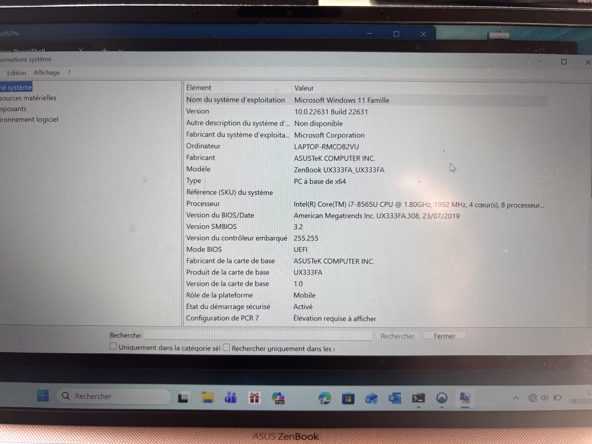

# Analyse de l'ordinateur OP-01

- **Auteur** : Christophe Donnat - DonnatDev - christophe@donnat.dev
- **Client** : Mme Sadedine Malika - DMM Conseils - dmmconseils@hotmail.com
- **Matériel examiné** : OP-01 (voir ci-dessous)
- **Début de l'analyse** : 08 octobre 2026 à 12:36:00
- **Remarques** : RAS

### Ordinateur portable OP-01

- **Marque :** ASUS
- **Modèle :** UX333F NOTEBOOK PC
- **Numéro de série :** KAN0CV116290436
- **Système d'exploitation :** WINDOWS 11 VERSION 23H2 X64
- **Quelques logiciels installés :** SAGE 50, ADOBE READER, ADOBE ACROBAT, CIEL PAYE EVOLUTION, WORD, EXCEL, OODRIVE_SIGN, OUTLOOK ,OPEN OFFICE 4.1.11, MICROSOFT TEAMS, PAPERCUT MF CLIENT, NORTON 360

### État antérieur

L'ordinateur a été remis au prestataire le 07/10/2026 à 16h15, avec câble d'alimentation et codes de dévérouillage.

---

## Acquisition de l'image disque

### Récupération de la clé BitLocker

L'ordinateur a été allumé par le prestataire le 08/10/2026 à 12h36 afin de récupérer la clé BitLocker et de vérifier l'état du système d'exploitation.

```powershell
Get-CimInstance Win32_Processor | Select-Object Name, Architecture
```

Intel(R) Core(TM) i7-8565U CPU @ 1.80Ghz

```powershell
msinfo32
```

{ width=50% }

### Désactivation de Secure Boot

Le 12/10/2026 à 8h55 environ, l'ordinateur a été redémarré et le Secure Boot a été désactivé dans le BIOS.

### Démarrage sur un support externe

Le 12/10/2026 à 8h57 environ, l'ordinateur a été démarré sur un SSD externe contenant un système d'exploitation Linux (Caine) pour permettre l'acquisition de l'image disque.

### Acquisition du disque avec Guymager

Le 12/10/2026 à 9h15 environ, l'acquisition du disque a été réalisée avec le logiciel Guymager. L'image disque a été sauvegardée sur un disque dur externe, dans sa partition `FORENSOC` de 1 To.

L'acquisition a été réalisée en mode "Read Only" pour éviter toute modification du disque source.

> L'image est enregistrée dans le fichier: `OP-01/OP01`	

